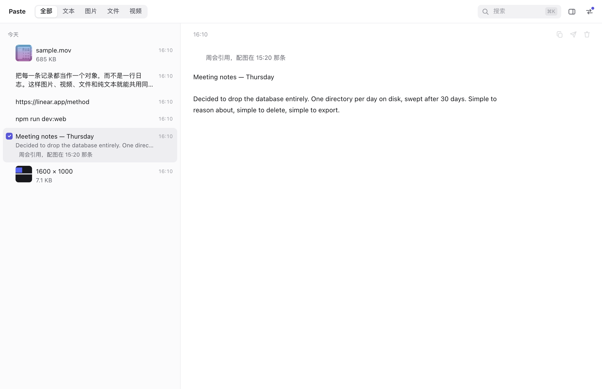
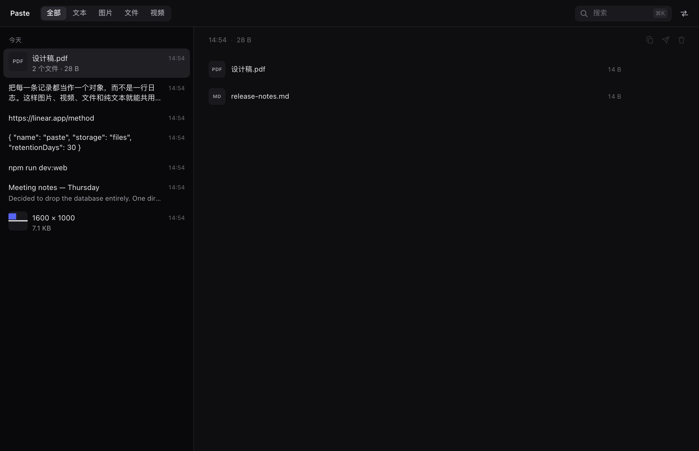
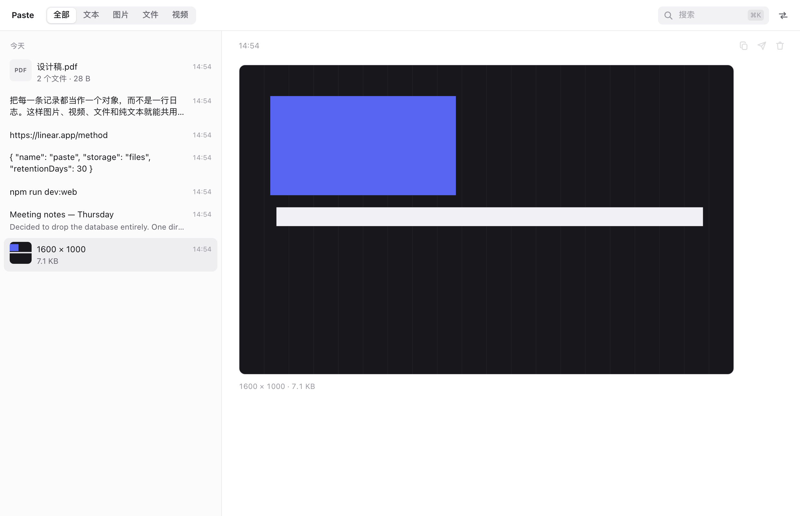
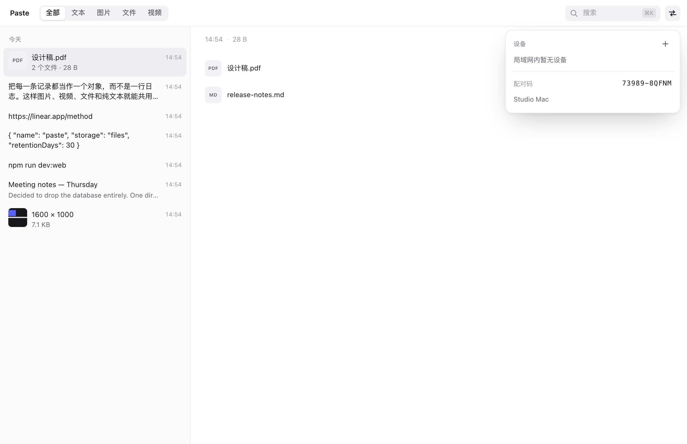

# Paste

一个安静的剪贴板。macOS 与 Windows 都能用，文件存储，30 天自动滚动，局域网直传。

没有数据库，没有构建步骤，没有框架，没有 npm 依赖：一个常驻的 Node 进程加三个静态文件。



<details>
<summary>深色 / 图片 / 设备面板</summary>





</details>

## 开始

需要 Node.js 20 或更新版本（[nodejs.org](https://nodejs.org)）。

**macOS**：双击 `Paste.command`。
**Windows**：双击 `Paste.cmd`。

它会在后台启动一个守护进程，然后用 Chrome/Edge 的 `--app` 模式打开一个没有标签页、没有地址栏、没有页脚的窗口。关掉窗口，记录仍在继续。

命令行方式：

```bash
npm start          # 前台运行，http://127.0.0.1:47810
npm run open       # 后台运行并打开无边框窗口
npm run stop       # 停止后台进程
npm test           # 73 项端到端检查，含双机配对与传输
```

## 记录什么

复制即可记录，不需要按任何键：

| 类型 | 来源 |
| --- | --- |
| 文本 | 任意应用里的复制，保留换行与缩进 |
| 图片 / 截图 | 截图到剪贴板、网页复制图片、复制图片文件 |
| 文件 | Finder / 资源管理器里复制的文件，可多选 |
| 视频 | 复制的视频文件，原样保存；能解码的直接播放 |

另外：任何文件都可以直接拖进窗口。

- **分类**：全部 / 文本 / 图片 / 文件 / 视频。
- **时间**：按天分组（今天、昨天、月日），列表顶部时间常驻。
- **检索**：输入即搜索，覆盖完整正文（不只是首屏预览），命中处高亮，并用一段上下文说明为什么命中。
- **复制回去**：点一下或回车，内容回到系统剪贴板。文本、图片、文件都会带回原文件名；图片同时带像素和文件 URL，粘到编辑器是图，粘到 Finder 是文件。从应用里复制不会在列表里再生成一条记录。
- **视频预览**：H.264/MP4 直接在窗口里播放；QuickTime（HEVC 等浏览器解不了的编码）显示 Quick Look 生成的封面帧，并给一个「用默认播放器打开」。
- **受保护来源**：读不到内容的文件不会假装成功——复制会被拒绝并提示授权，剪贴板保持原样。
- **备注**：每条记录可以写一句备注，常驻在列表行内和详情顶部，点一下就改；备注也参与搜索。写在 `meta.json` 里，跟着记录走。
- **删除可撤销**：删除后 12 秒内可恢复。
- **多选与批量**：⌘ 点击、⇧ 点击连选、⌘A 全选；批量复制（纯文本按空行拼接，含文件则按文件复制）、批量发送、批量删除。
- **收起预览**：⌘\ 或右上角按钮把右侧预览收起来，列表铺满窗口，操作不受影响（行内出现复制/删除，多选时浮动操作条在底部）。按钮在任何窗口宽度下都保留，状态会记住。
- **跟随系统深浅色**，窄窗口自动变成单栏。

## 键盘

| 键 | 作用 |
| --- | --- |
| `⌘K` | 搜索 |
| `↑` `↓` / `j` `k` | 移动选择 |
| `⏎` | 复制选中项 |
| `⌘⌫` | 删除 |
| `⌘1` … `⌘5` | 切换分类 |
| `⌘A` | 全选当前列表 |
| `⇧↑` `⇧↓` | 按范围多选 |
| `⌘\` | 收起 / 展开预览 |
| `Esc` | 关闭浮层 / 清空搜索 |

## 局域网互传

两台机器在同一个 Wi-Fi 下：

1. 各自打开 Paste，点右上角的设备图标。
2. 在其中一台上点 **＋**，填入另一台的 **地址与配对码**（配对码就在对面面板里，点一下即可复制）。
3. 配对完成后两台互相可见，在线状态有绿点。
4. 选中任意记录 → 详情右上角的纸飞机 → 选择设备。文本、图片、多文件、视频都能发。

配对码只用于「配对」这一步。配对时两端各生成一个独立密钥，之后传输只认密钥，配对码不再具备传输权限。所有请求都是局域网内的 HTTP，不经过任何服务器。

设备发现用 UDP 广播（47811），每 3 秒一次；收到广播的设备会单播回应，所以双向发现不依赖广播是否被网络丢掉。没有发现也能手动填地址。

## 权限：只影响「从别的 App 沙盒里复制文件」

macOS 不允许任何非特权进程读取别的 App 的容器目录（微信、QQ 的文件缓存都在自己的容器里）。所以从微信里复制图片、视频、压缩包时，Paste 能拿到文件名和大小，但读不到内容，列表里会显示 **未读取**。

三种处理方式，任选：

0. 已经记录下来的条目不用重新复制：详情里点 **重试**，授权后会把原始文件补进这条记录。
1. **授权（推荐，之后内容会被完整保存）**
   系统设置 → 隐私与安全性 → 完全磁盘访问权限 → 添加 `/usr/local/bin/node`（在添加面板里按 `⌘⇧G` 可以直接输路径）→ 重启 Paste。若用 `Paste.command` 启动，也可以直接给 Terminal 授权。
   应用内第一次遇到受保护文件时，右下角提示里的「授权」按钮会直接打开这个设置面板。
2. **拖拽**：把文件从微信直接拖进 Paste 窗口。拖拽会带上系统发放的临时授权，通常可以完整保存。
3. **不处理**：记录仍在（名称、大小、时间），点复制会把这个文件放回剪贴板，⌘V 到 Finder、邮件、微信都能用；内容不被复制，磁盘占用也更小。

从 Finder、桌面、下载、文档复制的文件不受影响，本来就会完整保存。

## 数据在哪

```
~/Library/Application Support/Paste/     # macOS
%APPDATA%\Paste\                          # Windows
```

```
config.json                 设备 id、名称、配对码、已配对设备
runtime.json                当前端口与进程（启动器用）
items/
  2026-11-26/
    mwx74y3mb34f2b/
      meta.json             这条记录的全部元数据（也是内存索引）
      body.txt              文本
      f0.png                图片（统一转 PNG）
      thumb.png             列表缩略图
      f0.mp4                文件原样保存
inbox/                      正在传输的分片，提交后即成一条记录
trash/                      刚删除、等待撤销的记录
tmp/                        临时文件，重启即清空
paste.log                   最近 1MB 日志
```

- 一天一个目录，一条记录一个目录。`meta.json` 是唯一真相，`ls` 就能看懂。
- 超过 30 天的**整天目录**被删除，启动时和每小时各检查一次。没有软删除队列，没有压缩，没有 VACUUM。
- 完全相同的复制内容会跳过（按内容哈希），不会产生重复记录。
- 备份就是复制这个目录；迁移就是把它拷到另一台机器。

## 安全

- 网页界面只监听回环地址，并要求启动时生成的会话 Cookie。局域网里的其他机器打不开界面（会收到 403）。
- 局域网 API 只认配对时交换的密钥；未配对设备的请求一律 401。
- 上传分片绑定发起方密钥，别台设备无法冒领别人的分片。
- 没有云，没有遥测，没有外部请求。

## 为什么这样架构

**为什么不用数据库。** 记录是天生的日志，按天分桶比任何 schema 都直观。没有迁移、没有锁、没有版本兼容，出问题直接用 Finder 修。搜索在内存里做：30 天几千条记录，线性扫描比建索引更快，也少一个会不同步的组件。

**为什么不用框架和构建。** 前端是三个静态文件 + 原生 ES 模块，改完刷新就生效。后端是 Node 内置的 `http`，零依赖，`npm i` 永远不需要跑。任何人和任何智能体都能在五分钟内读完整个代码库。

**为什么用 SSE 而不是 WebSocket。** 同步只需要服务器 → 浏览器一个方向；`EventSource` 自带重连，不用写心跳和握手。复制、传输、删除都会在毫秒内出现在界面上。

**为什么不用 Electron。** 剪贴板读取必须原生（macOS 用 JXA 的 ObjC 桥读 `NSPasteboard`，Windows 用 PowerShell 读 WinForms 剪贴板），界面没有理由也原生。用一个常驻的 Node 进程 + 系统自带浏览器，安装体积是 0；`--app` 模式提供的窗口本身就是无浏览器的。

```
┌────────────── 每台机器 ──────────────┐
│  watcher (JXA / PowerShell)          │  NSPasteboard.changeCount
│      │ 一行一个 JSON                  │  GetClipboardSequenceNumber
│      ▼                                │
│  capture ──► store (文件)  ──► HTTP   │  ← 同步 API（密钥）
│                 │              │      │
│              SSE 广播          ▼      │
│                 │        UI (localhost)│
│                 ▼                     │
│            UDP 发现 47811             │
└───────────────────────────────────────┘
```

## 开发

```
src/main.js              装配顺序：config → store → bundles → lan → capture → server
src/store.js             文件存储、30 天滚动、去重、撤销
src/search.js            内存检索与摘要片段
src/server.js            HTTP、会话鉴权、SSE、静态资源
src/lan.js               UDP 发现、配对、推送
src/transfer.js          分片上传（拖拽与局域网共用同一条路径）
src/capture.js           监督原生 watcher，带退避重启
src/clipboard/*          平台相关：读取剪贴板、写回剪贴板
src/copy.js              把记录放回系统剪贴板
public/                  界面（index.html / styles.css / app.js）
tools/shot.mjs           通过 CDP 截图，用于验证界面（可指定浅色/深色/宽度）
test/smoke.js            端到端：两个真实进程、真实配对、真实传输
```

调试环境变量：`PASTE_DATA`（数据目录）、`PASTE_PORT`、`PASTE_NO_CAPTURE=1`（不记录剪贴板）、`PASTE_NAME`、`PASTE_DEBUG=1`。

`npm test` 会真的写入系统剪贴板——它验证的是完整复制链路。所以跑测试时，正在运行的 Paste 会把测试用的临时文件记进历史；测完清一下即可。

界面改完用这个确认视觉效果：

```bash
node tools/shot.mjs --out /tmp/a.png --theme dark --width 1240 --height 800
```

## 开机自启（可选）

macOS：把下面内容存为 `~/Library/LaunchAgents/app.paste.plist`，路径改成你的目录，然后 `launchctl load` 它。

```xml
<?xml version="1.0" encoding="UTF-8"?>
<!DOCTYPE plist PUBLIC "-//Apple//DTD PLIST 1.0//EN" "http://www.apple.com/DTDs/PropertyList-1.0.dtd">
<plist version="1.0"><dict>
  <key>Label</key><string>app.paste</string>
  <key>ProgramArguments</key>
  <array><string>/usr/local/bin/node</string><string>/path/to/paste/src/main.js</string></array>
  <key>RunAtLoad</key><true/>
  <key>KeepAlive</key><true/>
</dict></plist>
```

Windows：`Win+R` → `shell:startup` → 放入 `Paste.cmd` 的快捷方式。

## 已知限制

- Windows 端代码路径完整（PowerShell 监听与写回），但本机只有 macOS，未在真实 Windows 上跑过测试；如果 `powershell.exe` 被策略限制，界面里的拖拽与手动添加仍然可用。
- 读不到内容的文件会以「未读取」的形式保留（名称、大小、原始路径），不会被静默丢弃；需要完整保存请见上面的权限一节。
- 单条记录只有 30 天生命周期；被删掉的原始临时文件即使还在记录里也无法再复制。
- 视频保存原文件，不做转码，因此 4K 长视频会占磁盘（默认单条上限 2GB，可用 `PASTE_MAX_FILE_MB` 调整）。
- 预览支持 PNG/JPEG/GIF/WebP 与常见视频容器；HEIC 会转 PNG，SVG 按文件处理。
- 界面只在回环地址可用，手机不能直接打开（有意为之）。
